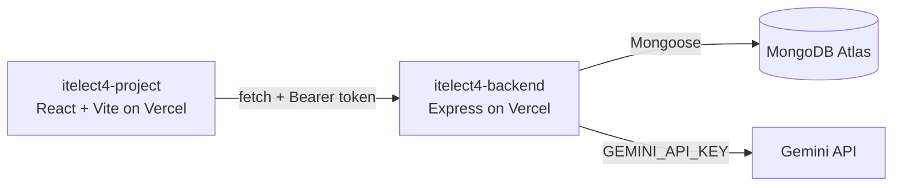

# itelect4-backend

REST API for the Peer Tutoring platform — **Express + TypeScript + MongoDB (Mongoose) + JWT**, with a
Gemini-powered Study Planner.

- **Live API:** https://itelect4-backend.vercel.app/api/health
- **Frontend repo:** [itelect4-project](https://github.com/haziaintsht/itelect4-project)

## Architecture

## Stack
- **Express 5** — routing, middleware, error handling
- **Mongoose** — MongoDB schemas that mirror the frontend's `User` / `Session` / `Booking` interfaces
- **JWT** — signed tokens from login/register, verified by a `protect` middleware
- **bcryptjs** — passwords stored as hashes, never plain text
- **Gemini** (`@google/genai`) — the Study Planner behind `POST /api/ai`, with replies checked by **Zod** and limited by **express-rate-limit**
- **TypeScript** — strict; import/export at compile time, erased at runtime (Session 2)

## Setup

1. `npm install`
2. Copy `.env.example` to `.env` and fill in `MONGODB_URI`, `JWT_SECRET`, the two `SEED_TUTOR_*` values
   and `GEMINI_API_KEY` (from [Google AI Studio](https://aistudio.google.com/apikey))
3. `npm run seed` — puts the demo tutor and the tutoring sessions into the database (safe to run again)
4. `npm run dev` → http://localhost:4000 — prints `API on http://localhost:4000` and `MongoDB connected: itelect4`

## Endpoints

| Method | Path | Auth | Body |
| --- | --- | --- | --- |
| GET | `/api/health` | public | — |
| POST | `/api/auth/register` | public | `{ name, email, password, role? }` |
| POST | `/api/auth/login` | public | `{ email, password }` |
| GET | `/api/sessions` | public | — |
| GET | `/api/sessions/:id` | public | — |
| POST | `/api/sessions` | Bearer, tutor only | `{ title, subject, description, sessionType?, meetingLink? }` |
| GET | `/api/bookings` | Bearer | — |
| GET | `/api/bookings/:id` | Bearer | — |
| POST | `/api/bookings` | Bearer | `{ session, note }` |
| PATCH | `/api/bookings/:id` | Bearer (status: tutor only) | `{ status?, note? }` |
| DELETE | `/api/bookings/:id` | Bearer | — |
| POST | `/api/ai` | Bearer, 5/min per user | `{ prompt }` (20–2000 characters) |

### `POST /api/ai` — Study Planner

Returns `{ summary, focusTopics: string[1–3], level: "beginner" | "intermediate" | "advanced", suggestedSubject }`.

| Status | When |
| --- | --- |
| 400 | `prompt` is missing, shorter than 20 or longer than 2000 characters |
| 401 | no Bearer token, or it is invalid/expired |
| 429 | more than 5 requests in a minute from this account, or the Gemini quota is used up |
| 502 | Gemini replied with something that is empty, not JSON, or does not match the schema |

The pieces: `src/ai/gemini.ts` (client + call), `src/ai/prompt.ts` (system prompt, 2 few-shot
examples, `<submission>` wrapping), `src/schemas/studyPlan.ts` (Zod request and reply schemas),
`src/middleware/rateLimit.ts`, `src/controllers/aiController.ts` and `src/routes/aiRoutes.ts`.

### Roles

- `POST /api/sessions` answers **403** unless the logged-in account is a `tutor`. `requireRole` in
  `src/middleware/auth.ts` reads the role from the database, so a role change needs no new login.
- `PATCH /api/bookings/:id` with a `status`: only the booking's **tutor** may change it (**403** otherwise),
  and only one step forward, `requested -> confirmed -> completed` (**400** for anything else).
- `DELETE /api/bookings/:id`: the tutee cancels, or the tutor declines.

## Scripts
- `npm run dev` — `tsx watch src/server.ts` (restarts on save)
- `npm run build` — `tsc` type-checks + emits to `dist/`
- `npm run start` — runs the compiled output
- `npm run seed` — upserts the tutoring sessions in `src/data/sessions.ts`; running it twice changes nothing
- `npm run typecheck` — `tsc --noEmit`
- `npm test` — runs the integration tests in `tests/` (needs `JWT_SECRET`)
- `npm run try-ai` — asks Gemini for a study plan straight from the terminal (no Express or MongoDB
  needed) to check the key and the network. Add your own text: `npm run try-ai -- "I am stuck on recursion"`

## Testing and CI

The tests use Vitest and Supertest against the real Express app. The database connection is replaced
with a no-op, and no test reaches Gemini: a too-short prompt proves a request got past the login check
without starting a Gemini call.

| File | What it checks |
| --- | --- |
| `tests/ai.test.ts` | `POST /api/ai`: 401 with no token or a forged token, 400 for an invalid body, 429 on the sixth request in a minute |
| `tests/sessions.test.ts` | `POST /api/sessions`: 401 with no token, 403 for a tutee, a tutor gets through |

GitHub Actions (`.github/workflows/ci.yml`) runs `npm ci`, `npm run typecheck` and `npm test` on every
push. It reads `JWT_SECRET` from the repository's Actions secrets (Settings → Secrets and variables →
Actions). That value is only used to sign test tokens, so it should not be your real one.

## How it runs

| | On your laptop | On Vercel |
| --- | --- | --- |
| Entry point | `src/server.ts` (calls `app.listen`) | `src/app.ts` (its default export) |
| Database connection | started by `server.ts`, awaited by the middleware | opened by the first request, reused after |
| Config | `.env` | Vercel → Settings → Environment Variables |

There is no `vercel.json`: Vercel finds the Express app in `src/app.ts` by itself.

## Deploy (Vercel)

1. **Atlas → Network Access → Add IP Address → Allow access from anywhere** (`0.0.0.0/0`, comment `Vercel`).
   Vercel's addresses change per request, so there is no fixed address to add. Keep your own entry too.
2. Push to GitHub. On vercel.com: **Add New → Project → Import** `itelect4-backend`.
   Root Directory `./`, preset **Express**.
3. Environment Variables: `MONGODB_URI`, `JWT_SECRET`, `JWT_EXPIRES_IN`, `CORS_ORIGIN`, and `GEMINI_API_KEY`.
   `CORS_ORIGIN` starts as `http://localhost:3000` until the frontend is deployed, then becomes the
   frontend's `https://<name>.vercel.app` (no trailing slash) — redeploy after changing it.
   Do not add `PORT`, and do not press Add beside MongoDB Atlas.
4. Deploy. The preview says `No route for GET /` — that is this app's own 404, so the app is running.
5. Open `https://<backend>.vercel.app/api/health`. It must answer `{"ok":true,"db":true}`.
   `db: false` (or a 500) means the Atlas access list or `MONGODB_URI` is wrong.

## AI Disclosure

- **In the app:** `POST /api/ai` sends the text a student types to Google Gemini. Its replies are
  AI-generated and can be wrong.
- **In development:** Claude Code, an AI coding assistant, was used to help write, test and document
  this project, including the Study Planner, the tutor role checks, the automated tests and the CI
  setup. I directed the work and am responsible for what is submitted.
